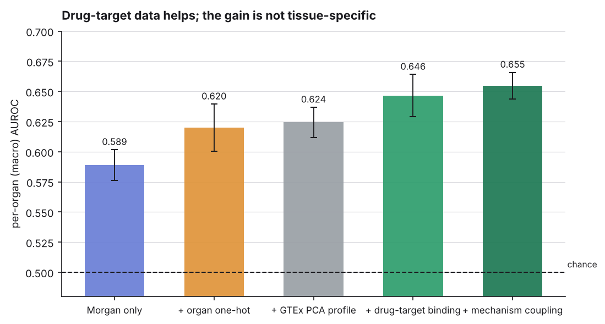
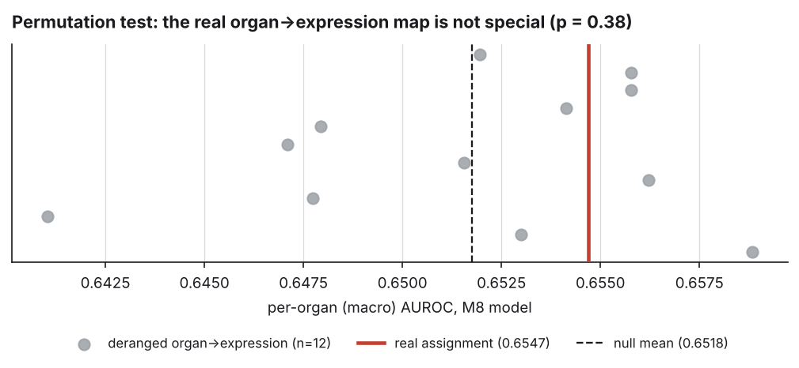

# EpiADR-Net

**A leakage-audited benchmark for organ-conditioned adverse drug reaction prediction — where drug–target data helps and tissue transcriptomics does not.**

[](https://github.com/ADjayantan/EpiADR-Net/actions)
[](https://www.python.org/)
[](https://opensource.org/licenses/MIT)

Given a drug's molecular structure and a target organ, predict whether the drug
causes that organ's characteristic adverse reaction. 1 465 molecules, 5 organs,
SIDER-derived labels, GTEx V8 transcriptomic organ profiles.

Two findings, and the contribution is that both are tested properly:

> **Drug–target binding helps.** Adding PubChem drug–target activity over a
> 94-gene pharmacological panel lifts macro-AUROC from 0.6197 (organ one-hot) to
> **0.6547 ± 0.011** — the best measured result on this task.
>
> **Tissue transcriptomics does not.** Multiplying that binding by each target's
> per-organ expression adds nothing identifiable: a 12-fold permutation test of
> the organ→expression map puts the real assignment at **p = 0.385**, with 4 of
> 12 *wrong* assignments scoring higher. True zero-shot generalisation — an
> unseen drug in an unseen organ — remains near chance at 0.579.





`RESULTS.md` has the full tables. `AUDIT.md` explains why the figures previously
published in this repository (Macro AUROC 0.7420, and 0.9680 in the manuscript)
were withdrawn.

---

## Results at a glance

Molecule-level Bemis-Murcko scaffold 5-fold CV. 0 shared molecules and 0 shared
scaffolds between train and test, asserted on every fold.

| model | macro-AUROC | macro-AUPRC |
|:--|--:|--:|
| per-organ base rate (no molecular input) | 0.5000 ± 0.000 | 0.2401 ± 0.008 |
| Morgan fingerprint only | 0.5888 ± 0.013 | 0.3121 ± 0.029 |
| Morgan + organ one-hot | 0.6197 ± 0.020 | 0.3522 ± 0.015 |
| Morgan + real GTEx PCA profile | 0.6243 ± 0.012 | 0.3510 ± 0.020 |
| Morgan + **shuffled** GTEx PCA profile | 0.6244 ± 0.013 | 0.3513 ± 0.023 |
| Morgan + XGBoost, per organ | 0.6364 ± 0.016 | 0.3862 ± 0.027 |
| Morgan + drug–target binding + one-hot | 0.6464 ± 0.018 | 0.3811 ± 0.021 |
| **+ mechanism coupling (M8)** | **0.6547 ± 0.011** | **0.3978 ± 0.020** |

**Per-organ AUROC is the primary metric, not pooled AUROC.** A predictor that
outputs nothing but each organ's base rate scores pooled AUROC 0.656 while ranking
no drug correctly — pooled figures on this task partly measure the Lung (7.8 %
positive) versus Brain (38.0 %) prevalence gap. See `RESULTS.md §1`.

---

## Why the tissue half fails

Organ assignment in this dataset comes from a MedDRA System Organ Class
terminology rule — hepatic terms map to Liver, arrhythmia terms to Heart, and so
on (`DATA_PROVENANCE.md`). The organ label is which ontological class a
side-effect term belongs to. It was never derived from tissue measurement, so
there is no transcriptomic signal for expression features to recover. With five
organs, "which organ" is ~2.3 bits; a one-hot already carries all of them, and a
128-dimensional profile adds 123 dimensions the label does not depend on.

That explains the split result. The binding vector describes the **drug**, which
the labels do encode — so it helps. The expression factor describes the
**organ**, which the labels encode only as an ontological class — so it does
not, and permuting it changes nothing (*p* = 0.385).

What remains untested is the other route: labels resolved by biology rather than
terminology — organ-specific signals from FAERS/OFFSIDES case data, or *in vitro*
organ-specific assays. Until the labels change, every organ-side feature is
bounded by the one-hot.

### A methodological note worth copying

A single-derangement ablation nearly produced a false positive here (+0.0088,
which looked real). With a fold s.d. of ~0.02 and a null spread of ±0.005, one
control draw cannot separate that from noise. Any tissue-conditioning claim of
this magnitude needs a permutation test over several derangements — see
`scripts/run_ablation_test.py`.

---

## Reproducing everything

```bash
pip install -r requirements.txt

make audit        # pipeline validity audit       -> results/audit_findings.json
make baselines    # baselines + tissue ablation   -> results/baselines.json
make zeroshot     # S1 / S2 / S3 generalisation   -> results/zeroshot.json
make mechanism    # drug-target x expression      -> results/mechanism.json
make ablation     # 12-fold permutation test      -> results/ablation_test.json
make results      # all of the above, in order
make test         # pytest
python scripts/make_figures.py

# refetching the external data (cached in data/external/, already committed)
make targets      # PubChem drug-target activity -> data/drug_target_matrix.csv
make expression   # HPA tissue nTPM              -> data/gene_tissue_expression.csv
```

Every number in `README.md` and `RESULTS.md` is written by one of those scripts
into `results/*.json`. Seeds are fixed (42). Nothing is transcribed by hand.

---

## Repository layout

```
epiadr/
  task.py        organ-conditioned task construction + schema validation
  splits.py      molecule-level Bemis-Murcko scaffold CV + leakage assertions
  features.py    Morgan fingerprints; real 128-dim GTEx profile loader
  eval.py        per-organ AUROC / AUPRC / ECE, fold aggregation
  gene_panel.py  the pre-specified 94-gene pharmacological panel
  mechanism.py   binding x expression coupling features
scripts/
  audit_pipeline.py    reproduces the validity audit in AUDIT.md
  run_baselines.py     baseline suite + tissue-shuffle ablation
  run_zeroshot.py      leave-one-organ-out generalisation (S1/S2/S3)
  fetch_targets.py     PubChem drug-target activity for the panel
  build_expression.py  HPA consensus tissue nTPM for the panel
  run_mechanism.py     M0-M9 feature comparison + leave-one-organ-out
  run_ablation_test.py permutation test of the organ->expression map
  make_figures.py      renders results/figures/*.png from the JSON
data/
  adr_records.csv            1 465 molecules x 5 organs, 10 MedDRA ADR labels
  tissue_profiles.csv        5 organs x 128 GTEx V8 PCA features
  drug_target_matrix.csv     1 465 molecules x 94 panel genes (PubChem)
  gene_tissue_expression.csv 94 genes x 5 organs (HPA nTPM + organ share)
model.py, train.py, utils.py, data_loader.py
                     the original graph-transformer pipeline, retained for
                     reference. Its reported metrics are withdrawn; see AUDIT.md.
app_gradio.py, app.py, api.py
                     Gradio Space, Streamlit dashboard, FastAPI service
docs/                presentation and viva material
```

---

## Status and honest limitations

- The graph-transformer model in `model.py` has **not** been re-benchmarked on the
  corrected task. The feature models above are the current reference; any GNN
  must beat **0.6547 ± 0.011** to be worth its parameters.
- PubChem "active" pools curated pharmacology with high-throughput screens, so
  the binding matrix means "has measured activity against", not "binds at
  affinity X". 58.6 % of molecules hit at least one panel gene; the rest
  contribute a zero binding vector.
- `data/adr_records.csv` is derived from SIDER 4.1 (CC BY-NC-SA 4.0) with
  PubChem SMILES resolution; `data/tissue_profiles.csv` from GTEx V8. See
  `DATA_PROVENANCE.md`.
- No external validation set. Cross-dataset evaluation (OFFSIDES / FAERS) is not
  done, so these numbers describe SIDER-derived labels only.
- **Not for clinical or preclinical decision-making.** This is a student research
  benchmark, not a validated safety model.

## License

MIT. Data under the licences recorded in `DATA_PROVENANCE.md`.
