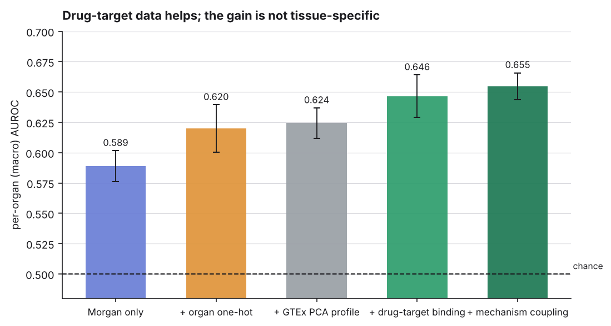
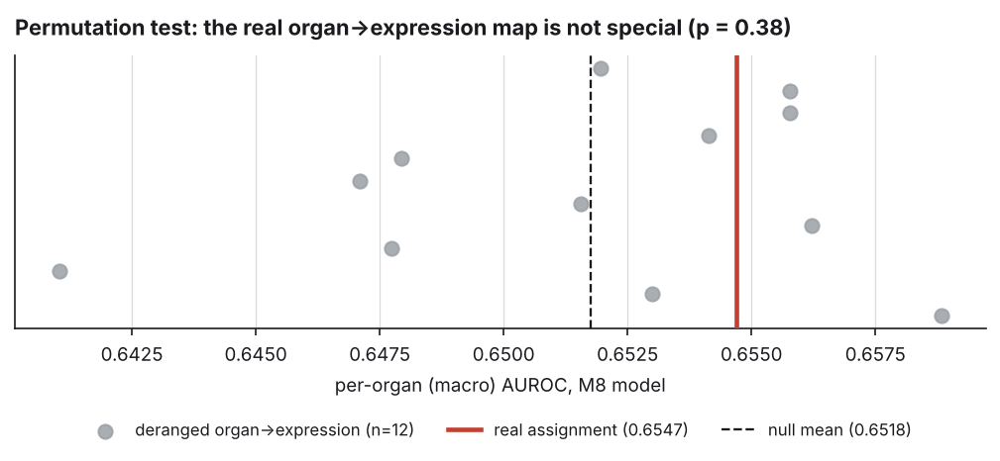

# EpiADR-Net — Results

All numbers on this page are produced by scripts in this repository and written to
`results/*.json`. Nothing here is transcribed by hand.

```bash
make results      # audit + baselines + zeroshot + mechanism + permutation test
python scripts/make_figures.py
```

| artefact | produced by |
|:--|:--|
| `results/audit_findings.json` | `scripts/audit_pipeline.py` |
| `results/baselines.json` | `scripts/run_baselines.py` |
| `results/zeroshot.json` | `scripts/run_zeroshot.py` |
| `results/mechanism.json` | `scripts/run_mechanism.py` |
| `results/ablation_test.json` | `scripts/run_ablation_test.py` |
| `results/figures/*.png` | `scripts/make_figures.py` |

---

## Task

`(molecule, organ) → P(that organ's adverse reaction)`, from SIDER-derived records.

| | |
|:--|:--|
| molecules | 1 465 |
| rows | 7 325 (5 organs × 1 465) |
| organ→ADR | Liver→Hepatotoxicity · Heart→Arrhythmia · Brain→Seizure · Kidney→Nephrotoxicity · Lung→Pneumonitis |
| tissue features | 128-dim GTEx V8 PCA profile per organ (`data/tissue_profiles.csv`) |
| split | molecule-level Bemis-Murcko scaffold 5-fold CV, seed 42 |
| leakage | 0 shared molecules, 0 shared scaffolds between train and test, asserted every fold |

Positive rate differs sharply by organ, which is why pooled metrics are not reported as headline:

| organ | Liver | Heart | Brain | Kidney | Lung |
|:--|--:|--:|--:|--:|--:|
| positives | 18.5 % | 29.2 % | 38.0 % | 26.5 % | 7.8 % |

---

## 1. Baselines and the tissue ablation


| model | macro-AUROC | macro-AUPRC | pooled-AUROC | ECE |
|:--|--:|--:|--:|--:|
| B0 pooled base rate | 0.5000 ± 0.000 | 0.2401 ± 0.008 | 0.5000 | 0.007 |
| B1 per-organ base rate | 0.5000 ± 0.000 | 0.2401 ± 0.008 | **0.6561** | 0.016 |
| B2 Morgan + LogReg, per organ | 0.5990 ± 0.021 | 0.3465 ± 0.016 | 0.6358 | 0.211 |
| **B3 Morgan + XGBoost, per organ** | **0.6364 ± 0.016** | **0.3862 ± 0.027** | 0.6904 | 0.111 |
| B4 Morgan + organ one-hot, shared | 0.6197 ± 0.020 | 0.3522 ± 0.015 | 0.6925 | 0.144 |
| B5 Morgan + **real GTEx** tissue, shared | 0.6243 ± 0.012 | 0.3510 ± 0.020 | 0.6949 | 0.141 |
| B6 Morgan + **shuffled** tissue, shared | 0.6244 ± 0.013 | 0.3513 ± 0.023 | 0.6954 | 0.140 |

**B1 is the reason pooled AUROC is not a headline metric.** A predictor with no
molecular input at all — it emits each organ's training base rate — reaches
pooled AUROC **0.656** while ranking no drug correctly (macro-AUROC exactly 0.500).
Any pooled figure on this task is partly a measurement of the Lung/Brain
prevalence gap.

**B5 vs B6 is the tissue ablation.** Replacing the real GTEx profiles with a
derangement — every organ gets another organ's transcriptome — changes
macro-AUROC by **−0.0001**. The model uses the tissue vector as an organ
identifier and nothing more. B4 (a plain one-hot) confirms it: 0.6197 vs 0.6243,
inside one standard deviation.

Note also that the shared tissue-conditioned model (0.6243) does **not** beat five
independent per-organ XGBoost models (0.6364).

### Per organ, best model


| organ | AUROC | AUPRC | positives |
|:--|--:|--:|--:|
| Liver | 0.6667 ± 0.015 | 0.3430 ± 0.042 | 18.5 % |
| Heart | 0.5990 ± 0.009 | 0.3983 ± 0.050 | 29.2 % |
| Brain | 0.6317 ± 0.027 | 0.5315 ± 0.052 | 38.0 % |
| Kidney | 0.6226 ± 0.041 | 0.4012 ± 0.063 | 26.5 % |
| Lung | 0.6621 ± 0.081 | 0.2572 ± 0.077 | 7.8 % |

---

## 2. Zero-shot generalisation

The repository previously described itself as zero-shot without testing it. Three
settings, increasingly strict:


| setting | molecule only | + organ one-hot | + GTEx tissue | tissue − one-hot |
|:--|--:|--:|--:|--:|
| **S1** unseen drug, seen organ | 0.5888 ± 0.013 | 0.6197 ± 0.020 | 0.6243 ± 0.012 | +0.005 |
| **S2** seen drug, unseen organ | **0.6975** | 0.6905 | 0.6965 | +0.006 |
| **S3** unseen drug + unseen organ | 0.5402 | 0.5464 | 0.5517 | +0.005 |

Reading these honestly:

* **S2 is the easy setting, not the hard one.** The held-out organ is new but the
  molecule is not: the model has already seen that drug's toxicity in four other
  organs, and organ-specific ADRs are positively correlated across organs
  (mean pairwise *r* = 0.196). S2 therefore measures *"is this drug broadly
  toxic"*, which transfers. A molecule-only model with no organ input at all is
  the **best** S2 model (0.6975) — conclusive evidence that nothing
  organ-specific is being transferred.
* **S3 is the real zero-shot claim, and it is near chance** (0.540–0.552).
  Predicting a new drug's toxicity in an organ never seen during training does
  not work on this data.
* **Tissue conditioning gains +0.005 macro-AUROC in all three settings**, against
  fold standard deviations of 0.012–0.020. That is noise, not an effect.

---

## 3. Mechanism features: drug–target binding × tissue expression

§1 and §2 leave one route untested. Any feature that is a function of the organ
*alone* is capped by what a 5-dimensional one-hot already encodes. A mechanism
feature is not such a function — it is a product:

```
m_g(drug, organ) = binds(drug, g) × expression(g, organ)
```

The mask depends on the drug, the magnitude on the organ. Two drugs in the same
organ get different vectors, and one drug gets different vectors across organs,
so it is recoverable from neither input alone.

**Data.** A pre-specified 94-gene pharmacological panel (`epiadr/gene_panel.py`),
fixed before any model was fitted and chosen by mechanism — hERG/KCNH2 for
arrhythmia, ABCB11/BSEP for cholestatic injury, SLC22A6/OAT1 for renal exposure,
GABA-A and NMDA subunits for seizure threshold, the CYPs for hepatic exposure.
Binding comes from PubChem assay outcomes (`scripts/fetch_targets.py`): 6 582
drug–target hits, 4.49 per molecule, 859/1 465 molecules (58.6 %) hitting at
least one panel gene. Expression comes from Human Protein Atlas consensus tissue
nTPM (`scripts/build_expression.py`), used instead of `data/tissue_profiles.csv`
because 128 principal components cannot be inverted back to genes.

The expression table reproduces textbook selectivity, which is the check that it
is wired up correctly:

| gene | peaks in | share of panel-organ total |
|:--|:--|--:|
| KCNH2 (hERG) | Heart | 68 % |
| CYP3A4 | Liver | 100 % |
| ABCB11 (BSEP) | Liver | 100 % |
| SLC22A6 (OAT1) | Kidney | 99 % |
| GRIN1 (NMDA) | Brain | 100 % |

### Results



| model | features | macro-AUROC | macro-AUPRC | vs one-hot |
|:--|--:|--:|--:|--:|
| M0 Morgan only | 2 048 | 0.5888 ± 0.013 | 0.3121 ± 0.029 | −0.031 |
| M1 Morgan + organ one-hot | 2 053 | 0.6197 ± 0.020 | 0.3522 ± 0.015 | — |
| M2 Morgan + GTEx PCA profile | 2 176 | 0.6243 ± 0.012 | 0.3510 ± 0.020 | +0.005 |
| M3 Morgan + binding | 2 142 | 0.6071 ± 0.026 | 0.3269 ± 0.030 | −0.013 |
| M4 Morgan + binding + one-hot | 2 147 | 0.6464 ± 0.018 | 0.3811 ± 0.021 | +0.027 |
| M5 Morgan + mechanism coupling | 2 242 | 0.6191 ± 0.020 | 0.3463 ± 0.023 | −0.001 |
| M6 M5, expression deranged | 2 242 | 0.6103 ± 0.016 | 0.3349 ± 0.023 | −0.009 |
| M7 mechanism only | 194 | 0.5734 ± 0.015 | 0.3311 ± 0.019 | −0.046 |
| **M8 Morgan + binding + one-hot + coupling** | 2 341 | **0.6547 ± 0.011** | **0.3978 ± 0.020** | **+0.035** |
| M9 binding + one-hot, no fingerprint | 99 | 0.5884 ± 0.006 | 0.3396 ± 0.012 | −0.031 |

**Drug–target data is a real gain.** M4 (+0.027) and M8 (+0.035) are the first
features in this repository to beat the organ one-hot by more than fold noise.
M8 is the new best model on the task, improving on the §1 reference (0.6364) and
with the lowest variance of any model tested.

**Coupling as a *replacement* for binding loses information.** M5 (0.6191) is
worse than M4 (0.6464) despite having strictly more engineered structure,
because M5 substitutes the product for the raw binding vector and so zeroes out
binding wherever expression is low. A gradient-boosted tree can already express
`organ == Liver AND binds ABCB11` from M4's separate columns; hand-coding the
product discards the parts. The coupling only helps when added *alongside* the
raw binding vector (M8), and then by +0.008 over M4.

### The permutation test

M5 beat its deranged control M6 by +0.0088, against the GTEx profile's −0.0001
in §1. That looked like the first positive signal — so it was tested properly.
`scripts/run_ablation_test.py` refits M8 under 12 independent derangements of
the organ→expression map and places the real assignment in that null.



| | macro-AUROC |
|:--|--:|
| real organ→expression assignment | 0.6547 |
| null (12 derangements) | 0.6518 ± 0.0050, range 0.6410–0.6588 |
| effect | +0.0029 |
| derangements ≥ real | **4 / 12** |
| empirical *p* | **0.385** |

**Not significant.** Four of twelve wrong organ→expression assignments scored
higher than the correct one. The +0.0088 from the single-derangement comparison
was a draw from this null, not an effect.

The conclusion is therefore split, and both halves matter:

* **Drug–target binding carries real signal** (+0.035 over an organ one-hot).
  Knowing a drug hits CYP2C9, hERG or BSEP helps predict organ toxicity.
* **The tissue-expression coupling does not.** The mechanism block's small
  contribution survives permuting which organ each gene's expression belongs to,
  so it is functioning as extra drug-level descriptors — a nonlinear re-encoding
  of the binding vector — not as tissue biology.

### Generalisation, with mechanism features

| setting | M1 one-hot | M4 binding+one-hot | M5 coupling | M8 full |
|:--|--:|--:|--:|--:|
| S2 seen drug, unseen organ | 0.6905 | 0.6997 | 0.6929 | 0.6992 |
| S3 unseen drug + unseen organ | 0.5464 | 0.5659 | 0.5664 | **0.5786** |

M8 is the best S3 model (+0.032 over the one-hot), but S3 remains close to
chance for every feature set, and in §2's single-derangement comparison the
deranged variant scored *higher* than the real one (0.5692 vs 0.5664). No
transfer across organs is established.

### A methodological note

A single-derangement ablation nearly produced a false positive here. With a fold
standard deviation of ~0.02 and a null spread of ±0.005, one control draw cannot
separate +0.008 from noise. Any tissue-conditioning claim of this size needs a
permutation test over several derangements, not one.

---

## 4. Why tissue conditioning does not help here

This is a property of the labels, not of the architecture, and no amount of model
capacity will change it.

`DATA_PROVENANCE.md` records how organ assignment was done: MedDRA System Organ
Class terms were mapped to organs by a terminology rule (hepatic terms → Liver,
cardiac arrhythmia terms → Heart, and so on). The label for an organ is therefore
*which MedDRA class the side-effect term belongs to* — a linguistic and
ontological fact. It was never derived from any measurement of tissue biology.

GTEx expression cannot recover signal that was never encoded. With five organs,
"which organ" is five bits of information, and a one-hot carries all five. A
128-dimensional transcriptome carries the same five bits plus 123 dimensions of
nothing the label depends on.

§3 tested the mechanistic-coupling route directly, with real drug–target data
and real per-gene expression, and the coupling did not survive a permutation
test. The binding information helped; its multiplication by tissue expression
did not. That is consistent with this explanation rather than against it: the
binding vector describes the *drug*, which the labels do encode, while the
expression factor describes the *organ*, which the labels encode only as an
ontological class.

**What remains untested is the other route: labels that are organ-resolved by
biology rather than by terminology** — organ-specific signals mined from
FAERS/OFFSIDES case data, or *in vitro* organ-specific toxicity assays. Until
the labels change, every organ-side feature is bounded by the one-hot.

---

## 5. What replaced the previously reported figures

| previously reported | where | actual |
|:--|:--|:--|
| Macro AUROC 0.7420 ± 0.031 | README, MODEL_CARD, SLIDES, VIVA_CHEATSHEET | not reproducible; see `AUDIT.md` |
| Macro AUROC 0.9680 | MANUSCRIPT | not reproducible; contradicted the README's own figure |
| "150+ FDA-approved drugs, 10 organs, 15 000 samples" | MANUSCRIPT | the pipeline trained on **5** molecules |
| "zero-shot" | throughout | untested; now measured as S3 = 0.552 |

Best honest figure on this task today: **macro-AUROC 0.6547 ± 0.011**
(M8 — Morgan fingerprint + PubChem drug–target binding + organ one-hot +
mechanism coupling, scaffold CV). The §1 fingerprint-only reference is
0.6364 ± 0.016.
