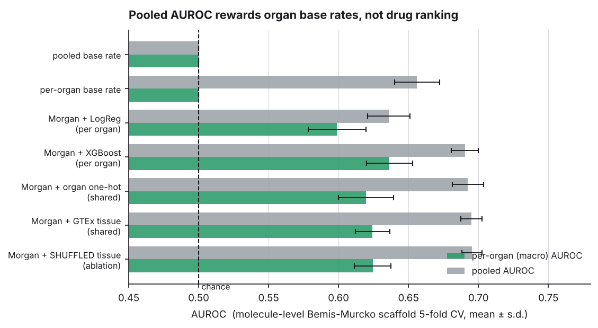
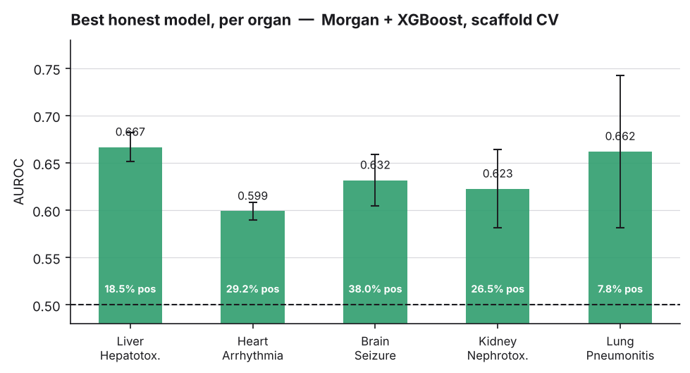
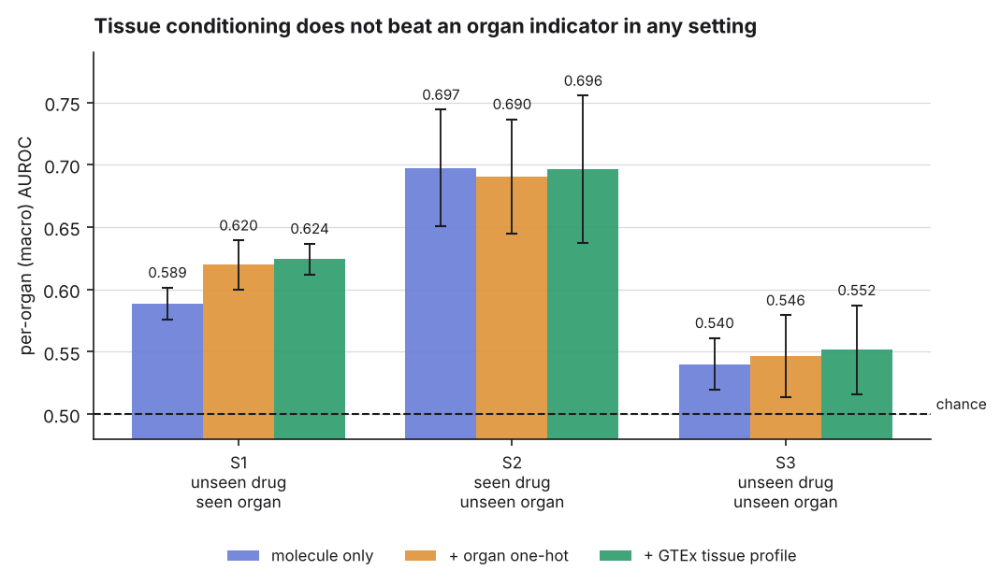

# EpiADR-Net — Results

All numbers on this page are produced by scripts in this repository and written to
`results/*.json`. Nothing here is transcribed by hand.

```bash
make results      # audit + baselines + zeroshot
python scripts/make_figures.py
```

| artefact | produced by |
|:--|:--|
| `results/audit_findings.json` | `scripts/audit_pipeline.py` |
| `results/baselines.json` | `scripts/run_baselines.py` |
| `results/zeroshot.json` | `scripts/run_zeroshot.py` |
| `results/figures/*.png` | `scripts/make_figures.py` |

---

## Task

`(molecule, organ) → P(that organ's adverse reaction)`, from SIDER-derived records.

| | |
|:--|:--|
| molecules | 1 465 |
| rows | 7 325 (5 organs × 1 465) |
| organ→ADR | Liver→Hepatotoxicity · Heart→Arrhythmia · Brain→Seizure · Kidney→Nephrotoxicity · Lung→Pneumonitis |
| tissue features | 128-dim GTEx V8 PCA profile per organ (`data/tissue_profiles.csv`) |
| split | molecule-level Bemis-Murcko scaffold 5-fold CV, seed 42 |
| leakage | 0 shared molecules, 0 shared scaffolds between train and test, asserted every fold |

Positive rate differs sharply by organ, which is why pooled metrics are not reported as headline:

| organ | Liver | Heart | Brain | Kidney | Lung |
|:--|--:|--:|--:|--:|--:|
| positives | 18.5 % | 29.2 % | 38.0 % | 26.5 % | 7.8 % |

---

## 1. Baselines and the tissue ablation



| model | macro-AUROC | macro-AUPRC | pooled-AUROC | ECE |
|:--|--:|--:|--:|--:|
| B0 pooled base rate | 0.5000 ± 0.000 | 0.2401 ± 0.008 | 0.5000 | 0.007 |
| B1 per-organ base rate | 0.5000 ± 0.000 | 0.2401 ± 0.008 | **0.6561** | 0.016 |
| B2 Morgan + LogReg, per organ | 0.5990 ± 0.021 | 0.3465 ± 0.016 | 0.6358 | 0.211 |
| **B3 Morgan + XGBoost, per organ** | **0.6364 ± 0.016** | **0.3862 ± 0.027** | 0.6904 | 0.111 |
| B4 Morgan + organ one-hot, shared | 0.6197 ± 0.020 | 0.3522 ± 0.015 | 0.6925 | 0.144 |
| B5 Morgan + **real GTEx** tissue, shared | 0.6243 ± 0.012 | 0.3510 ± 0.020 | 0.6949 | 0.141 |
| B6 Morgan + **shuffled** tissue, shared | 0.6244 ± 0.013 | 0.3513 ± 0.023 | 0.6954 | 0.140 |

**B1 is the reason pooled AUROC is not a headline metric.** A predictor with no
molecular input at all — it emits each organ's training base rate — reaches
pooled AUROC **0.656** while ranking no drug correctly (macro-AUROC exactly 0.500).
Any pooled figure on this task is partly a measurement of the Lung/Brain
prevalence gap.

**B5 vs B6 is the tissue ablation.** Replacing the real GTEx profiles with a
derangement — every organ gets another organ's transcriptome — changes
macro-AUROC by **−0.0001**. The model uses the tissue vector as an organ
identifier and nothing more. B4 (a plain one-hot) confirms it: 0.6197 vs 0.6243,
inside one standard deviation.

Note also that the shared tissue-conditioned model (0.6243) does **not** beat five
independent per-organ XGBoost models (0.6364).

### Per organ, best model



| organ | AUROC | AUPRC | positives |
|:--|--:|--:|--:|
| Liver | 0.6667 ± 0.015 | 0.3430 ± 0.042 | 18.5 % |
| Heart | 0.5990 ± 0.009 | 0.3983 ± 0.050 | 29.2 % |
| Brain | 0.6317 ± 0.027 | 0.5315 ± 0.052 | 38.0 % |
| Kidney | 0.6226 ± 0.041 | 0.4012 ± 0.063 | 26.5 % |
| Lung | 0.6621 ± 0.081 | 0.2572 ± 0.077 | 7.8 % |

---

## 2. Zero-shot generalisation

The repository previously described itself as zero-shot without testing it. Three
settings, increasingly strict:



| setting | molecule only | + organ one-hot | + GTEx tissue | tissue − one-hot |
|:--|--:|--:|--:|--:|
| **S1** unseen drug, seen organ | 0.5888 ± 0.013 | 0.6197 ± 0.020 | 0.6243 ± 0.012 | +0.005 |
| **S2** seen drug, unseen organ | **0.6975** | 0.6905 | 0.6965 | +0.006 |
| **S3** unseen drug + unseen organ | 0.5402 | 0.5464 | 0.5517 | +0.005 |

Reading these honestly:

* **S2 is the easy setting, not the hard one.** The held-out organ is new but the
  molecule is not: the model has already seen that drug's toxicity in four other
  organs, and organ-specific ADRs are positively correlated across organs
  (mean pairwise *r* = 0.196). S2 therefore measures *"is this drug broadly
  toxic"*, which transfers. A molecule-only model with no organ input at all is
  the **best** S2 model (0.6975) — conclusive evidence that nothing
  organ-specific is being transferred.
* **S3 is the real zero-shot claim, and it is near chance** (0.540–0.552).
  Predicting a new drug's toxicity in an organ never seen during training does
  not work on this data.
* **Tissue conditioning gains +0.005 macro-AUROC in all three settings**, against
  fold standard deviations of 0.012–0.020. That is noise, not an effect.

---

## 3. Why tissue conditioning does not help here

This is a property of the labels, not of the architecture, and no amount of model
capacity will change it.

`DATA_PROVENANCE.md` records how organ assignment was done: MedDRA System Organ
Class terms were mapped to organs by a terminology rule (hepatic terms → Liver,
cardiac arrhythmia terms → Heart, and so on). The label for an organ is therefore
*which MedDRA class the side-effect term belongs to* — a linguistic and
ontological fact. It was never derived from any measurement of tissue biology.

GTEx expression cannot recover signal that was never encoded. With five organs,
"which organ" is five bits of information, and a one-hot carries all five. A
128-dimensional transcriptome carries the same five bits plus 123 dimensions of
nothing the label depends on.

**Making tissue conditioning measurable requires labels that are organ-resolved
by biology rather than by terminology**, or features that couple molecule and
tissue mechanistically — for example drug–target binding (ChEMBL/DrugBank)
multiplied by that target's expression in each tissue (GTEx). A mechanistic
feature of that kind is not derivable from an organ identifier, so it is capable
of beating the one-hot in principle. That is the stated next step; it is not
claimed here.

---

## 4. What replaced the previously reported figures

| previously reported | where | actual |
|:--|:--|:--|
| Macro AUROC 0.7420 ± 0.031 | README, MODEL_CARD, SLIDES, VIVA_CHEATSHEET | not reproducible; see `AUDIT.md` |
| Macro AUROC 0.9680 | MANUSCRIPT | not reproducible; contradicted the README's own figure |
| "150+ FDA-approved drugs, 10 organs, 15 000 samples" | MANUSCRIPT | the pipeline trained on **5** molecules |
| "zero-shot" | throughout | untested; now measured as S3 = 0.552 |

Best honest figure on this task today: **macro-AUROC 0.6364 ± 0.016**
(Morgan fingerprint + XGBoost, per organ, scaffold CV).
