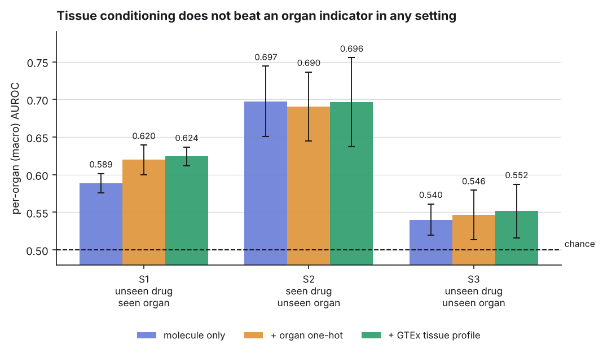
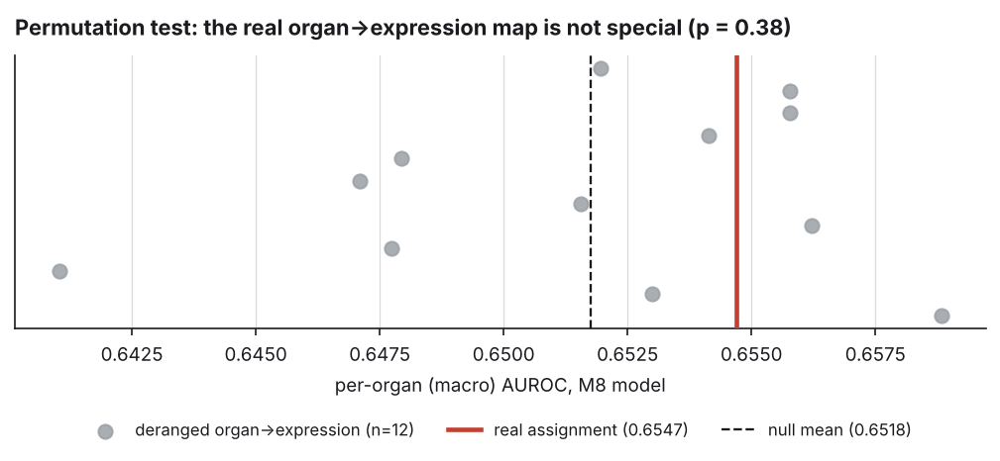

# EpiADR-Net
## Organ-conditioned ADR prediction: drug–target data helps, tissue transcriptomics does not

**A. D. Jayantan**
1 465 molecules · 5 organs · SIDER 4.1 + GTEx V8

[github.com/ADjayantan/EpiADR-Net](https://github.com/ADjayantan/EpiADR-Net)

---

# The question

Given a drug's **structure** and a **target organ**, does the drug cause that
organ's characteristic adverse reaction?

| organ | adverse reaction | positives |
| :--- | :--- | ---: |
| Liver | Hepatotoxicity | 18.5 % |
| Heart | Arrhythmia | 29.2 % |
| Brain | Seizure | 38.0 % |
| Kidney | Nephrotoxicity | 26.5 % |
| Lung | Pneumonitis | 7.8 % |

The intuition everyone starts with: *condition the molecule on the organ's
transcriptome.* This talk is about testing that properly.

---

# Protocol — built to be hard to fool

**Split:** Bemis-Murcko scaffolds assigned whole to folds, at the **molecule**
level — all five organ rows of a drug move together.

**Asserted, not assumed:** `verify_no_leakage()` raises unless shared molecules
and shared scaffolds are both zero. Runs on every fold, and in CI.

**Metric:** per-organ AUROC, macro-averaged. Plus AUPRC (imbalance) and ECE
(the app shows a probability).

**Reproducible:** `make results` writes every number to `results/*.json`.
Nothing on these slides is typed by hand.

---

# Finding 1 — pooled AUROC is not a valid headline

| predictor | macro-AUROC | pooled-AUROC |
| :--- | ---: | ---: |
| **per-organ base rate, no molecular input** | **0.500** | **0.656** |
| Morgan + LogReg, per organ | 0.599 ± .021 | 0.636 |
| Morgan + XGBoost, per organ | **0.636 ± .016** | 0.690 |

A predictor that **never looks at the molecule** scores pooled 0.656 — it is just
separating Lung (7.8 %) from Brain (38.0 %).

Within an organ the base rate is constant. Per-organ AUROC measures drug ranking
and nothing else.

---

# Finding 2 — tissue conditioning fails a derangement ablation

| features | macro-AUROC |
| :--- | ---: |
| molecule only | 0.589 ± .013 |
| + organ one-hot (**5** dim) | 0.620 ± .020 |
| + real GTEx profile (**128** dim) | 0.624 ± .012 |
| + **deranged** GTEx profile | 0.624 ± .013 |

Give every organ **another organ's transcriptome**: macro-AUROC moves by
**−0.0001**.

The model used the 128-dim profile as a lookup key for organ identity.
5 dimensions buy the same thing 128 do.

---

# Finding 3 — strict zero-shot is near chance

**S2 is the trap.** Often reported as "zero-shot across tissues", it is the
*easiest* setting — the drug is not held out. The best S2 model is
**molecule-only, no organ input** (0.697).

**S3** holds out drug *and* organ: **0.552**.

---

# Finding 4 — drug–target activity **does** help

Pre-specified 94-gene pharmacological panel (hERG, BSEP, OAT1, CYPs, GABA-A, NMDA…),
PubChem binding data, HPA per-gene tissue expression.

| model | macro-AUROC | vs one-hot |
| :--- | ---: | ---: |
| Morgan only | 0.589 ± .013 | −0.031 |
| + organ one-hot | 0.620 ± .020 | — |
| + GTEx PCA profile | 0.624 ± .012 | +0.005 |
| + **drug–target binding** | 0.646 ± .018 | **+0.027** |
| + mechanism coupling (**M8**) | **0.655 ± .011** | **+0.035** |

First feature in the project to beat the one-hot by more than fold noise.

---

# Finding 5 — but the gain is **not** tissue-specific

A single derangement said the coupling gained **+0.0088**. That looked real.
So we built the null properly — **12 independent derangements**:

| real | null (n=12) | ≥ real | *p* |
| ---: | ---: | ---: | ---: |
| 0.6547 | 0.6518 ± 0.0050 | **4 / 12** | **0.385** |

Four *wrong* organ→expression maps scored higher than the correct one.

---

# The lesson

> With a fold s.d. of 0.02 and a null spread of 0.005, a **single-derangement
> ablation cannot separate +0.008 from noise** — and would have produced a false
> positive here.

The binding vector describes the **drug** — the labels encode that → it helps.
The expression factor describes the **organ** — the labels encode that only as
an ontological class → it does not.

Hand-coding `binds × expr` *in place of* binding also **hurt** (0.619 vs 0.646):
a boosted tree already forms `organ == Liver AND binds ABCB11` from two columns.

---

# Why — the labels, not the model

Organ assignment comes from a **MedDRA System Organ Class terminology mapping**
(`DATA_PROVENANCE.md`): hepatic terms → Liver, arrhythmia terms → Heart, …

The label encodes **which ontological class a term belongs to**.
No tissue measurement enters its construction.

> Expression data cannot recover signal that was never encoded.

Five organs ≈ 2.3 bits — a one-hot carries all of them. The other 123 dimensions
describe biology the label does not depend on.

**Capacity cannot fix this.** The limit is in the target, not the function class.

---

# What would make it testable

**1. Mechanistic coupling features** — ✅ **tested**

$$\text{feature}_g(d, \text{organ}) = \text{binds}(d, g)\cdot \text{expression}(g, \text{organ})$$

Does not rescue it: permutation test *p* = 0.385.

**2. Labels resolved by biology, not terminology** — ❌ **untested, and what is left**

FAERS / OFFSIDES case-level signals; *in vitro* organ-specific assays.

Until the labels change, every organ-side feature is bounded above by a
five-dimensional one-hot.

---

# Methodological takeaway

A tissue-conditioning claim needs **two controls**, or it is not a claim:

1. an **organ one-hot** baseline, and
2. a **derangement ablation**.

Without them, *"the model uses tissue biology"* and *"the model knows which organ
this is"* are indistinguishable.

---

# On the earlier numbers

This repository previously reported **0.742** (README) and **0.968** (manuscript).
Both are withdrawn. `AUDIT.md`, reproducible via `scripts/audit_pipeline.py`:

1. `data/adr_records.csv` was **never read** — the loaders were dead code
2. tissue vectors were `np.random.dirichlet` **noise**, not GTEx
3. the target **did not depend on the organ** — 0 / 1 465 molecules varied
4. the benchmark trained on **5 molecules**, one held out per fold

Finding this, documenting it, and republishing corrected numbers is the result.

---

# Contributions

1. **Benchmark** — leakage-audited, molecule-level scaffold CV, every number
   emitted by a script
2. **Metric correction** — pooled AUROC invalid here (0.656 with no input)
3. **A real improvement** — drug–target activity, **+0.035** over an organ one-hot
4. **Required control** — the **permutation test**, not a single derangement
5. **Diagnosed negative result** on the tissue half, with the one route left named

Best honest result: **macro-AUROC 0.6547 ± 0.011** (M8)
True zero-shot (S3): **0.5786**

`make results` · [github.com/ADjayantan/EpiADR-Net](https://github.com/ADjayantan/EpiADR-Net)
